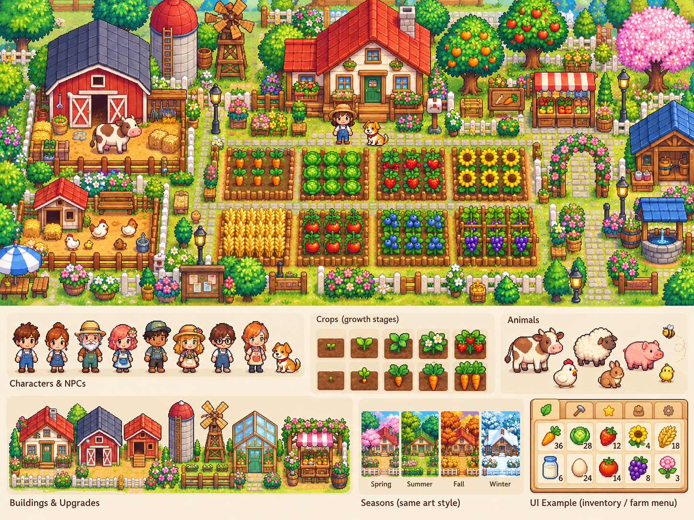

# What We Sow

### Grow a farm. Shape a lifetime.

*Concept art. Game in development.*

Plant, harvest, and build a farm of your own across 40 in-game years.

🌱 **Start small.** Turn a few plots into a thriving farm.

🍂 **Watch life change.** Seasons turn. Your family and community grow.

🤝 **Make hard choices.** What you gain, and what you give up, shapes the years ahead.

A single-player farming game for your browser.

**What will you leave behind?**
