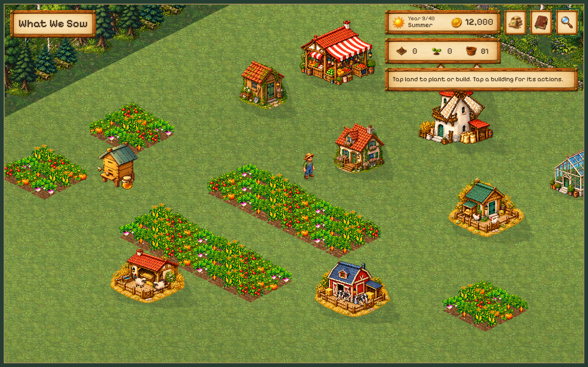
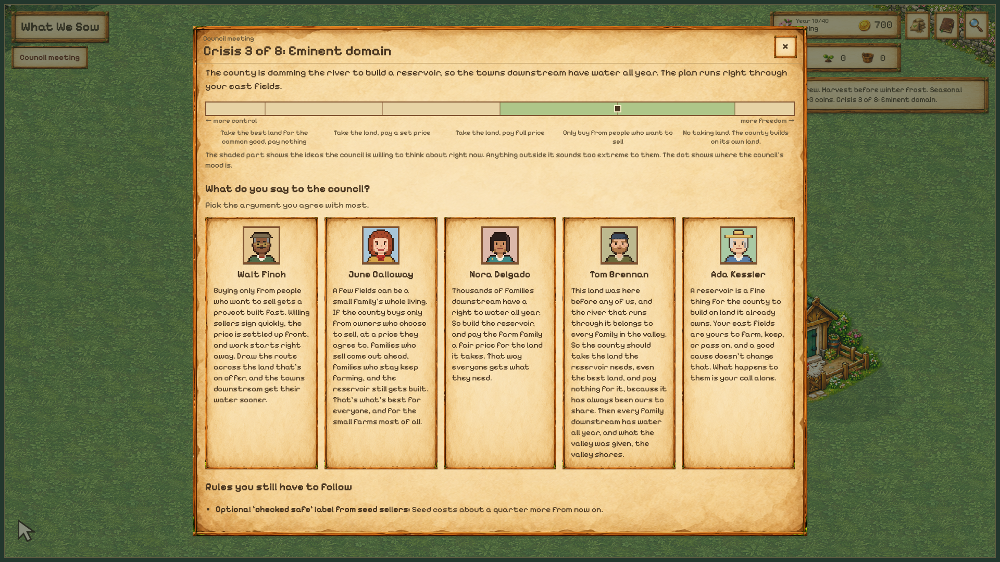

# What We Sow

### Grow a farm. Shape a lifetime.



*Actual gameplay from a development save. Game in development.*

Plant, harvest, and build a farm of your own across 40 in-game years.

🌱 **Start small.** Turn a few plots into a thriving farm.

🍂 **Watch life change.** Seasons turn. Your family and community grow.

🤝 **Make hard choices.** What you gain, and what you give up, shapes the years ahead.

A single-player farming game for your browser.



*Choose your argument at the council. The policy that passes changes your farm.*

**What will you leave behind?**

## Work on the game

Start with [the session guide](docs/session-start.md) for the current playable scope, code map, and checks. [Development](docs/development.md) covers setup, isolated instances, saves, and deployment.

```sh
corepack enable
pnpm install
pnpm dev --instance validation-my-task
```

Use the printed URL, including its query string. Run `pnpm validate` before handing over substantive changes.

[Video preparation](videos/README.md) covers isolated gameplay recording and the separate HyperFrames tools for the planned demo.

Watch the one-minute demo at [/video](https://whatwesow.com/video), or use its Play button to open the game. The video starts muted and includes playback controls.
